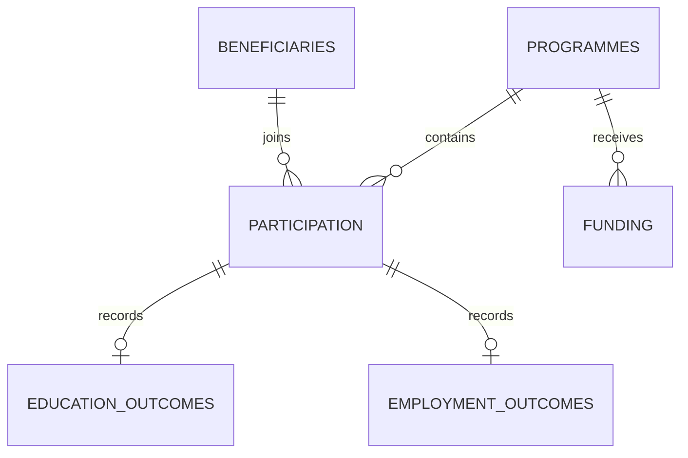

# Education Outcomes Database

A reproducible SQL project exploring how a programme team might monitor learner outcomes without confusing attendance patterns with evidence of effectiveness.

## Question

Does the observed proficiency of different attendance groups support changing tutoring provision? The analysis first defines an eligible cohort, then checks education stage and attendance together before drawing conclusions.

The starting context came from an education-outcomes team project. This repository contains a newly written public implementation, with generated data and additional validation. It is not a charity deployment or an archive of the group's original MySQL dump.

## Data model

Six tables separate people, programmes, participation, education outcomes, employment outcomes and funding. Numeric keys replace names. Programme-specific participation/outcome keys prevent cross-programme joins from multiplying learner records.



The fixture has **20 synthetic beneficiaries across two programmes**, with 24 illustrative funding entries. It contains no real participant data. The employment/funding amounts are generated examples and are not evidence of programme impact.

## Run

From this directory:

```bash
python3 education.py
python3 -m unittest discover -s tests -v
```

Outputs: `build/results.json`, four CSV summaries and `build/findings.md`. Python 3.10+ and its bundled SQLite library are sufficient.

The SQL in [`schema.sql`](sql/schema.sql) and [`analysis.sql`](sql/analysis.sql) is SQLite-compatible. It is not presented as MySQL code tested against a live MySQL server.

## Analytical process

1. Model the relations and enforce keys, programme links and valid indicator values.
2. Select active learners with non-missing baseline/follow-up education labels.
3. Check that joined rows equal distinct learner keys within the selected programme.
4. Calculate proficiency by education stage and by weekly attendance.
5. Cross-tab stage and attendance to examine whether the groups are comparable.
6. Report both the observed pattern and what the data cannot establish.

`NULL` attendance is labelled **Unknown**, rather than being assigned to the highest group. Missing scores are excluded from proficiency denominators; each summary reports both cohort size and observed-score count. Funding is aggregated separately from participation to avoid multiplying money by participant counts.

## Demonstration findings

| Group | Learners | Maths proficient | Rate |
|---|---:|---:|---:|
| Lower secondary | 5 | 2 | 40% |
| Upper secondary | 3 | 3 | 100% |
| High attendance (>6 h/week) | 5 | 3 | 60% |
| Medium attendance (>3 to 6 h/week) | 2 | 2 | 100% |

These are two views of the same nine-person eligible cohort, not independent samples to combine.

The counterintuitive attendance result prompts a composition check: the high-attendance group contains four lower-secondary learners and one primary learner; the medium group contains two upper-secondary learners. The data lack overlap for a reliable within-stage comparison. More hours cannot be interpreted as causing worse results.

**Decision implication:** define comparable cohorts and collect baseline attainment before using attendance-group averages to change tutoring intensity. This project produces a defensible analysis and identifies a data requirement; it does not claim student improvement or financial savings.

## Validation and limitations

Focused checks cover duplicate/orphan rejection, cross-programme join amplification, missing hours, missing-score denominators, stage composition and funding reconciliation. The fixture is deliberately small. Education-stage labels and one observation per person/programme are simplifications; longitudinal evaluation would require dated observations and stronger identification assumptions.
