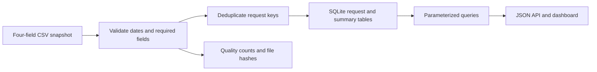

# NYC 311 Demand Explorer

A local data pipeline and dashboard for comparing reported service demand across NYC boroughs and identifying the most frequently reported issues in a selected month.

## Problem and intended user

Operations analysts need a consistent way to see where reported demand is concentrated before deciding which issues need investigation. Repeatedly reading request-level files complicates this comparison. The project produces reusable monthly summaries and serves borough totals and issue rankings through a small JSON API.

The tool supports further review. It does not infer issue severity, allocate crews or demonstrate that a city agency used its findings.

## Pipeline



1. Read `unique_key`, `created_date`, `borough` and `complaint_type`.
2. Reject missing keys/issues and invalid dates. Keep the first valid row for a duplicate key.
3. Normalize borough labels; retain unassigned borough records in an `UNSPECIFIED` bucket for reconciliation.
4. Build one summary row per month, borough and issue.
5. Reconcile accepted request counts with summary totals, then replace the local serving snapshot in one transaction.
6. Serve borough comparisons and top-issue rankings with a fixed borough/month denominator.

Dates are grouped by the calendar month in the source value. The downloader requests NYC's published creation-date field; this edition does not perform a separate timezone conversion.

## Offline quick start

From this directory:

```bash
python3 src/pipeline.py --input data/synthetic_requests.csv
python3 src/app.py
```

Open `http://127.0.0.1:8000`. The bundled March/April fixture contains **68 input rows**: **66 accepted, 1 duplicate and 1 rejected date**, producing **20 summary rows**. Two accepted requests have unspecified boroughs and remain outside five-borough comparisons.

These are synthetic demonstration counts. They are not the original six-month team-project results.

## Optional public-data run

```bash
# Default: a capped 5,000-row extract, not a representative monthly sample.
python3 src/download.py --month 2025-03 --output build/public_requests.csv
python3 src/pipeline.py --input build/public_requests.csv

# Request a complete month instead; runtime and API availability vary.
python3 src/download.py --month 2025-03 --max-rows 0 --output build/full_month.csv
python3 src/pipeline.py --input build/full_month.csv
```

Only the four listed fields are requested. No addresses, coordinates, descriptions or contact information are downloaded. A manifest records the retrieval time, selected fields, cap and whether the query was exhausted. The API may update during pagination; save the downloaded snapshot and inspect its quality report. The optional live download has not been exercised as part of this offline preparation.

For multiple months, pass all files together:

```bash
python3 src/pipeline.py --input build/march.csv build/april.csv
```

**Load behavior:** this edition replaces the entire local snapshot, not one partition. Include every month you want to retain. Re-running the same input produces the same counts without appending duplicates. Duplicate handling is first-valid-row-wins; conflicting duplicate content is not resolved using update timestamps in this four-field edition.

## API examples

```text
/api/boroughs?month=2025-03
/api/top-issues?month=2025-03&borough=MANHATTAN&limit=3
/api/quality
```

For each top issue:

```text
share = issue requests / all accepted requests in the same borough and month
daily average = issue requests / days in the calendar month
```

Changing the number of returned issues does not change the denominator. Unsupported boroughs, malformed months and invalid limits receive a 400 response. Queries use bound parameters.

## Validation

```bash
python3 -m unittest discover -s tests -v
```

Checks cover reconciliation, duplicate/rejected rows, idempotent reloads, partial top-N denominators, invalid input preserving the previous snapshot, empty months, API routes and query validation. The server binds to localhost and is intended for local exploration, not production hosting.

## Interpretation and limitations

- Request counts measure reported demand, influenced by reporting behavior and coverage.
- A small or capped extract cannot establish full-month rankings.
- Fewer summary rows do not establish a measured speedup, storage saving or service improvement.
- This public edition uses SQLite and a standard-library HTTP server. Distributed PySpark processing, native PostgreSQL, Flask and MongoDB audit logging belong to the broader original design, not this edition's tested execution stack.
- Incremental refreshes, production deployment and representative performance benchmarks remain future work.

## Sources

- [NYC Open Data: 311 Service Requests from 2020 to Present](https://data.cityofnewyork.us/Social-Services/311-Service-Requests-from-2020-to-Present/erm2-nwe9)
- [NYC Open Data Terms of Use](https://data.cityofnewyork.us/stories/s/Terms-of-Use/k9k7-3cje)
- [Source code](src/pipeline.py), [local API](src/app.py), [public downloader](src/download.py)
